<div align="center">

# Cathet

**A sleek, ultra-lightweight, cross-platform frosted-glass text & markdown editor for Windows, Linux, and Android that just gets out of your way.**

[](https://github.com/Crlyzd/Cathet)
[](https://github.com/Crlyzd/Cathet/releases)
[](LICENSE)
[](https://github.com/Crlyzd/Cathet/releases/latest)

<br/>

<!--
📸 SCREENSHOT SPEC #01: HERO BANNER
- Target File: docs/screenshots/hero-crossplatform-showcase.jpg
- Platform: Multi-Platform Composite (Windows Desktop + Android Mobile + Linux)
- Theme: Dark Glass / Acrylic
- Aspect Ratio / Dimensions: 1920x800 or 1600x700 (Widescreen banner)
- State to Capture: Layered visual showcase showing Windows Acrylic frosted window, Android phone running Cathet Home/Notes, and Linux desktop side-by-side over a vibrant, stylish backdrop.
-->
<p align="center">
  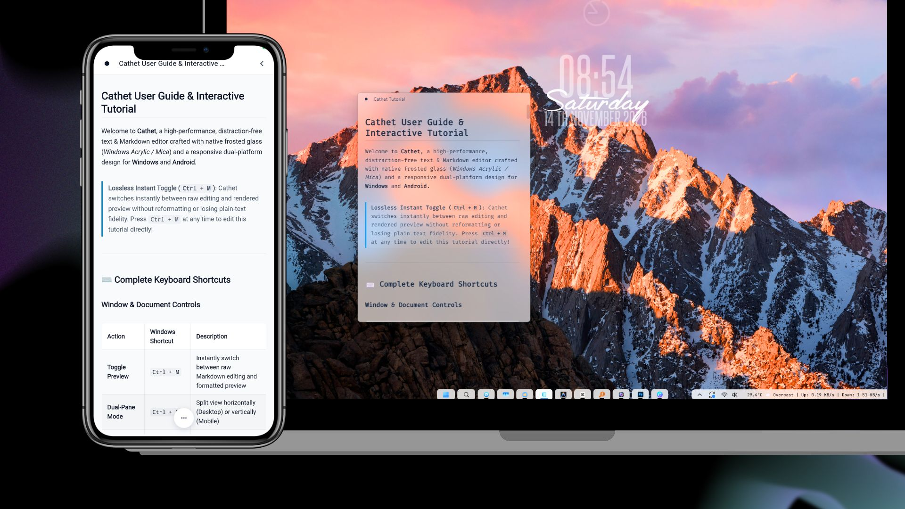
</p>

*Clean, distraction-free writing that looks right at home on your desktop and phone.*

</div>

---

```
**cath·et** `/tʃaˈʈət/` *(cha-thet / chah-tuht)* • **verb & noun**

*Origin:* Javanese (**ꦕꦛꦼꦠ꧀**, *basa Jawa*), cognate to Indonesian *catat*.
1. **(Verb)** To write down, to jot down, to note, or to record.
2. **(Noun)** A written note, record, or memorandum (*cathetan*).
3. **(Computing)** A sleek, ultra-lightweight, cross-platform frosted-glass text and markdown editor that just gets out of your way.
```

---

## ✨ Why Cathet?

Standard Notepad feels plain, dated, and lacks formatting. Meanwhile, modern markdown and note-taking apps have become heavy electron beasts that hog gigabytes of RAM, take seconds to launch, and trap your thoughts in proprietary silos.

**Cathet** bridges the gap with a featherweight native footprint and premium frosted glass aesthetics:

| Feature | Standard Notepad | Heavy Note Apps | Cathet |
| :--- | :---: | :---: | :---: |
| **Startup Speed** | Instant | 2–5 Seconds | **< 150ms Instant** |
| **Binary Size** | ~3 MB | 120–250 MB | **~3.5–3.9 MB** |
| **Memory Footprint** | Low | 150–500 MB RAM | **Ultra-low (~25–40 MB)** |
| **Backdrop Vibrancy** | Flat / Boring | Flat CSS / Fake Blur | **Hardware Acrylic, Mica & Glass** |
| **Markdown Preview** | ❌ No | ✅ Yes | **✅ Lossless Instant Toggle (`Ctrl+M`)** |
| **Dual-Pane Mode** | ❌ No | Limited | **✅ Horizontal & Vertical Dual-Pane** |
| **Cross-Platform Sync**| Windows only | Heavy Cloud Sync | **✅ Windows + Linux + Android (Local & Offline)** |
| **Image Handling** | ❌ None | Uploads / Stored Blobs | **✅ In-Memory WebP Optimization & Base64 Pills** |
| **High Refresh Rate** | Standard | Standard | **✅ 120Hz/144Hz/165Hz Android Unlock** |

---

## ✍️ Markdown Superpowers (Zero-Bloat, 100% Lossless)

Cathet isn't just a frosted-glass Notepad—under the hood it packs a **zero-dependency Tier 2 GitHub Flavored Markdown (GFM) engine** engineered to stay fast, faithful, and completely out of your way:

- **100% Lossless Instant Toggle (`Ctrl+M`)**: Flip between raw Markdown and rendered Preview instantaneously without re-serializing, stripping whitespace, or mutating your underlying plain text.
- **Summonable Floating Toolbar (`Ctrl+/` or `⋯ → Format Toolbar`)**: Keep the glass canvas distraction-free until you need formatting tools. Dock it **Top**, **Bottom**, or **Left** in Settings—with non-occluding insets so it never covers text, dual-pane headers, or the sync badge—plus an `L`/`R` active-pane target indicator, 5-type Alert popover, and automatic hide in Preview mode.
- **Extended GFM & Technical Writing**: Native support for **GitHub Alerts** (`[!NOTE]`, `[!TIP]`, `[!IMPORTANT]`, `[!WARNING]`, `[!CAUTION]`), **YAML Frontmatter** metadata pills, inline `$math$` & display `$$math$$` blocks, interactive nested & numbered task lists, clickable `[^1]` footnotes, fenced code language headers with one-click **Copy**, `~sub~` / `^sup^` / `==highlight==`, `<details>` accordions, reference links, and escaped table pipes (`\|`).
- **Smart Clipboard & Image Pipeline**: Rich HTML-to-Markdown paste conversion (`sub`, `sup`, fenced code languages), in-memory WebP compression (>500 KB) folded into interactive `[ 📷 WEBP ~245 KB ▾ ]` pills, and Android Gboard `CommitContent` sticker/GIF support.

<!--
📸 SCREENSHOT SPEC #18: MARKDOWN SUPERPOWERS & FLOATING TOOLBAR
- Target File: docs/screenshots/windows-floating-toolbar-markdown.webp
- Platform: Windows 11 Desktop
- Theme: Dark Mode (Acrylic)
- Aspect Ratio: 1280x720 window crop
- State to Capture: Dual-Pane mode (`Ctrl+D`) with the Floating Markdown Toolbar (`Ctrl+/`) docked at the bottom (showing `L` active-pane badge and 5-type Alert popover or formatting buttons) while Left pane shows raw Markdown/frontmatter/alerts and Right pane renders styled Alerts, Math, Task Lists, and Code Copy headers.
-->
<p align="center">
  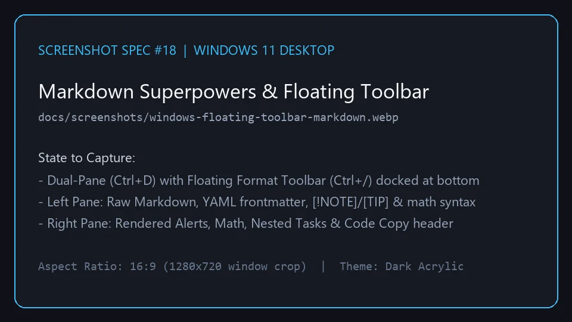
</p>

---

## 🪟 Windows Desktop Showcase

Cathet leverages native Windows Desktop Window Manager (DWM) APIs for hardware-accelerated **Acrylic** and **Mica** system backdrops. Your workspace seamlessly blurs and reflects your desktop wallpaper.

### Edit Mode & Markdown Preview

Switch seamlessly between raw distraction-free editing and rendered GitHub Flavored Markdown (GFM) with a single keystroke (`Ctrl + M`).

<div align="center">
  <table>
    <tr>
      <td width="50%" align="center">
        <!--
        📸 SCREENSHOT SPEC #02: WINDOWS ACRYLIC DARK EDITOR
        - Target File: docs/screenshots/windows-acrylic-dark-editor.webp
        - Platform: Windows 11 (x64 / ARM64)
        - Theme: Dark Mode
        - Aspect Ratio: 1280x720 window crop
        - State to Capture: Main editor window in Edit Mode floating over a colorful wallpaper.
        - Text Content: Markdown headings (`# Project Notes`), bullet lists, checklist items (`- [x] Done`, `- [ ] Next`), and a short code snippet. Frosted top bar and frameless window controls clearly visible.
        -->
        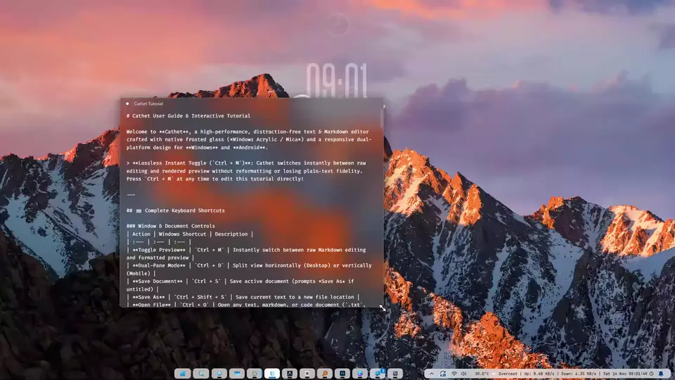<br/>
        <b>Dark Mode — Hardware-Accelerated Acrylic Editor</b>
      </td>
      <td width="50%" align="center">
        <!--
        📸 SCREENSHOT SPEC #03: WINDOWS PREVIEW LIGHT
        - Target File: docs/screenshots/windows-preview-light.webp
        - Platform: Windows 11 (x64 / ARM64)
        - Theme: Light Mode
        - Aspect Ratio: 1280x720 window crop
        - State to Capture: Markdown Preview Mode (`Ctrl+M`) active on translucent light frosted glass.
        - Text Content: Rendered typography: styled headers, clickable links, formatted markdown table, blockquotes, and syntax-highlighted code block.
        -->
        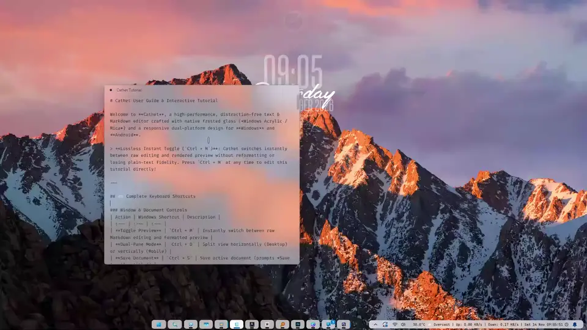<br/>
        <b>Light Mode — Rendered Markdown Preview (`Ctrl+M`)</b>
      </td>
    </tr>
  </table>
</div>

### Side-by-Side Dual Pane (`Ctrl + D`)

Split your window into two panes to draft and preview simultaneously, compare documents, or reference notes. Drag the frosted central splitter with proportional or snap scroll synchronization.

<!--
📸 SCREENSHOT SPEC #04: WINDOWS DUAL-PANE HORIZONTAL
- Target File: docs/screenshots/windows-dualpane-horizontal.webp
- Platform: Windows 11 Desktop
- Theme: Dark Mode
- Aspect Ratio: 1440x810 or 1280x720 window crop
- State to Capture: Dual-Pane mode active (`Ctrl+D`). Left pane in Edit mode with markdown syntax; Right pane in Preview mode with rendered output. Central frosted glass splitter with visible `Locked Standard` badge.
-->
<p align="center">
  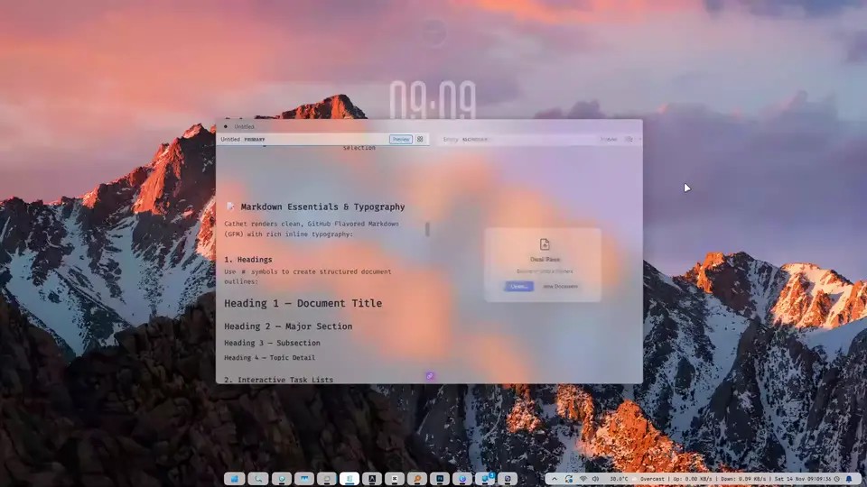
</p>

### Collapsible Image Pills & Frosted Context Menus

Large pasted clipboard images are compressed to WebP in-memory and folded into compact, interactive frosted glass pill badges. Right-click anywhere for custom glass menus without clumsy native popups.

<div align="center">
  <table>
    <tr>
      <td width="50%" align="center">
        <!--
        📸 SCREENSHOT SPEC #05: WINDOWS BASE64 PILL BADGE
        - Target File: docs/screenshots/windows-base64-pill-badge.webp
        - Platform: Windows 11 Desktop
        - Theme: Dark Mode
        - Aspect Ratio: ~800x450 close-up crop
        - State to Capture: Edit mode with several lines of text and an inline collapsible pill badge: `[ 📷 WEBP ~245 KB ▾ ]`.
        -->
        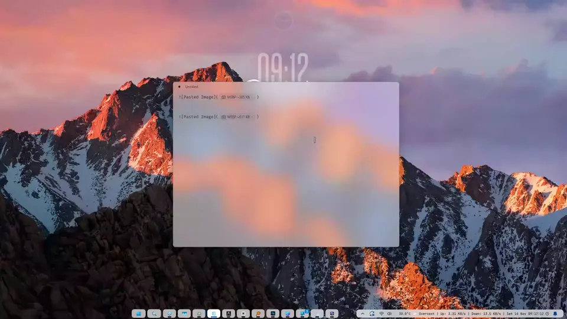<br/>
        <b>In-Memory Base64 Collapsible Image Badge</b>
      </td>
      <td width="50%" align="center">
        <!--
        📸 SCREENSHOT SPEC #07: WINDOWS CONTEXT MENU GLASS
        - Target File: docs/screenshots/windows-context-menu-glass.png
        - Platform: Windows 11 Desktop
        - Theme: Dark Mode
        - Aspect Ratio: ~800x450 close-up crop
        - State to Capture: Frosted glass context menu open showing Cut, Copy, Paste, Format, Word Wrap, and static "Search in Web" options.
        -->
        <br/>
        <b>Custom Frosted Glass Right-Click Context Menu</b>
      </td>
    </tr>
  </table>
</div>

---

## 🐧 Linux Desktop Showcase

Cathet on Linux runs natively on **GTK 3 & WebKitGTK 4.1**—enjoying lightning-fast startup and tiny binary sizes without Electron or Chromium baggage.

<div align="center">
  <table>
    <tr>
      <td width="50%" align="center">
        <!--
        📸 SCREENSHOT SPEC #08: LINUX GNOME SOLID SLATE
        - Target File: docs/screenshots/linux-gnome-solid-slate.png
        - Platform: Linux (Ubuntu / GNOME / Wayland)
        - Theme: Dark Solid Slate (`#12141c`)
        - Aspect Ratio: 1280x720 window crop
        - State to Capture: Cathet running on GNOME desktop with default solid slate dark background. Native header styling and crisp typography with zero Wayland see-through bleed.
        -->
        <br/>
        <b>Default Solid Slate Canvas (GNOME / Ubuntu / Fedora)</b>
      </td>
      <td width="50%" align="center">
        <!--
        📸 SCREENSHOT SPEC #09: LINUX KDE TRANSLUCENT BLUR
        - Target File: docs/screenshots/linux-kde-translucent-blur.png
        - Platform: Linux (KDE Plasma 6 / KWin)
        - Theme: Dark Translucent Glass
        - Aspect Ratio: 1280x720 window crop
        - State to Capture: Translucent Glass mode enabled in Cathet settings, floating over a colorful KDE desktop with KWin force-blur effect active.
        -->
        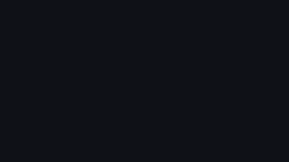<br/>
        <b>Translucent Frosted Glass with KWin Force-Blur (KDE Plasma)</b>
      </td>
    </tr>
  </table>
</div>

- **Auto-Detects Desktop Environments**: Recognizes KDE Plasma, GNOME, XFCE, Cinnamon, and MATE out of the box.
- **Solid Slate by Default**: Avoids Wayland compositor transparency bugs with an opaque slate canvas (`#12141c` dark / `#f8fafc` light).
- **Featherweight Packaging**: Tiny native `.deb` (3.3 MB) and `.rpm` (3.3 MB) packages, plus a standalone portable `.AppImage`.

---

## 📱 Android Mobile Showcase

Cathet on Android brings desktop-class markdown editing to your phone with high-refresh-rate hardware acceleration and Xiaomi HyperOS-inspired motion physics.

<div align="center">
  <table>
    <tr>
      <td width="33%" align="center">
        <!--
        📸 SCREENSHOT SPEC #10: ANDROID HOME DASHBOARD
        - Target File: docs/screenshots/android-home-dashboard.jpg
        - Platform: Android Phone (API 24+)
        - Theme: Dark Mode
        - Aspect Ratio: 1080x2400 (Mobile Portrait 9:20)
        - State to Capture: Android Notes Home view (`HomeView`). Folder category tabs (`All`, `Work`, `Personal`), search bar, note tiles with tag pills, and circular floating `+` action button.
        -->
        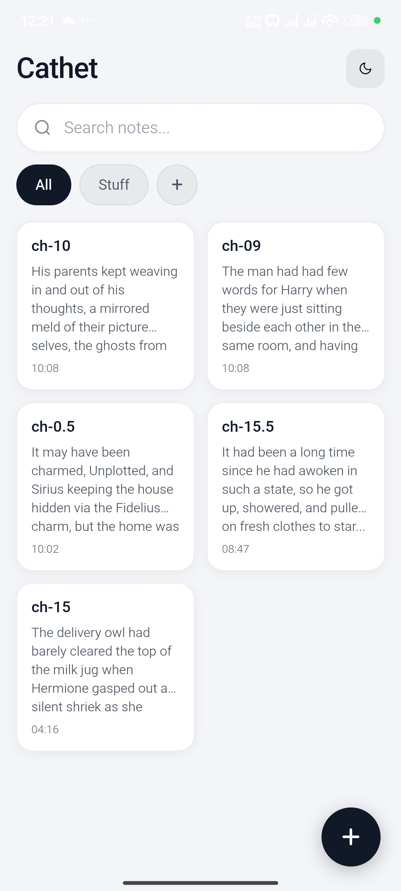<br/>
        <b>1. Notes Home Dashboard</b>
      </td>
      <td width="33%" align="center">
        <!--
        📸 SCREENSHOT SPEC #11: ANDROID VAULT ROTARY DIAL
        - Target File: docs/screenshots/android-vault-rotary-dial.webp
        - Platform: Android Phone
        - Theme: Dark Mode
        - Aspect Ratio: 1080x2400 (Mobile Portrait 9:20)
        - State to Capture: Private Notes unlock gesture in action. Pull-down and drag-right gesture revealing the mechanical safe tumbler HUD at top of screen with key dial rotated 90° and cardinal ticks aligned.
        -->
        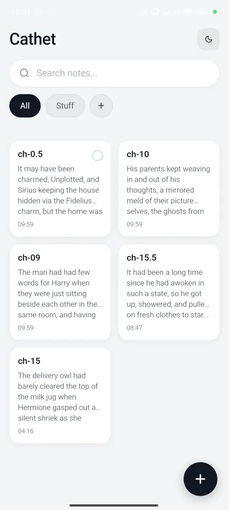<br/>
        <b>2. Rotary Tumbler Vault HUD</b>
      </td>
      <td width="33%" align="center">
        <!--
        📸 SCREENSHOT SPEC #12: ANDROID HOME MULTISELECT
        - Target File: docs/screenshots/android-home-multiselect.webp
        - Platform: Android Phone
        - Theme: Dark Mode
        - Aspect Ratio: 1080x2400 (Mobile Portrait 9:20)
        - State to Capture: Multi-select batch mode active on Notes Home. Top action bar showing item count, Pin, Hide, Move, Delete icons; multiple note tiles selected with checkmark badges.
        -->
        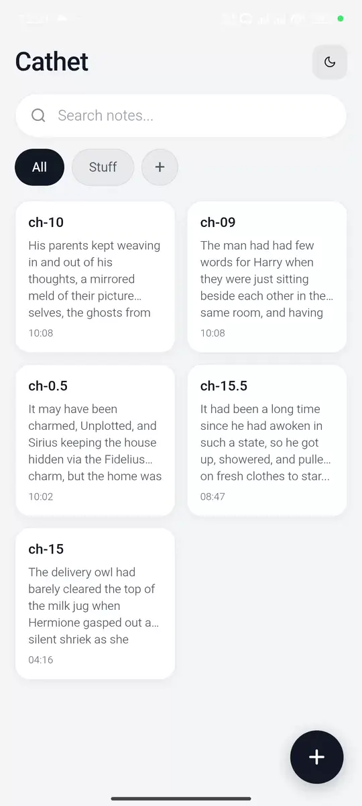<br/>
        <b>3. Multi-Select Batch Actions</b>
      </td>
    </tr>
  </table>
</div>

<br/>

<div align="center">
  <table>
    <tr>
      <td width="33%" align="center">
        <!--
        📸 SCREENSHOT SPEC #13: ANDROID EDITOR GBOARD IMAGE
        - Target File: docs/screenshots/android-editor-gboard-image.webp
        - Platform: Android Phone
        - Theme: Dark Mode
        - Aspect Ratio: 1080x2400 (Mobile Portrait 9:20)
        - State to Capture: Editor active with Gboard keyboard open. User inserting a sticker/GIF via Gboard Commit Content API, showing image rendered directly inline with note markdown text.
        -->
        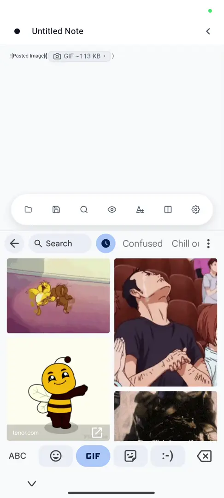<br/>
        <b>4. Gboard Sticker & Image Commit</b>
      </td>
      <td width="33%" align="center">
        <!--
        📸 SCREENSHOT SPEC #14: ANDROID IN-DOC SEARCH
        - Target File: docs/screenshots/android-in-doc-search.webp
        - Platform: Android Phone
        - Theme: Dark Mode
        - Aspect Ratio: 1080x2400 (Mobile Portrait 9:20)
        - State to Capture: In-document search ribbon active at top of editor. Search query typed, matches highlighted with CSS Custom Highlight API, Gboard keyboard remaining smoothly focused.
        -->
        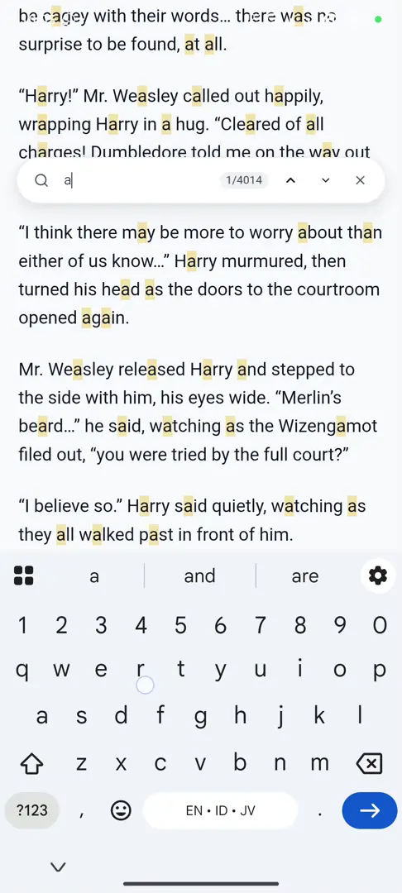<br/>
        <b>5. Focus-Preserving Search</b>
      </td>
      <td width="33%" align="center">
        <!--
        📸 SCREENSHOT SPEC #15: ANDROID DUAL-PANE VERTICAL
        - Target File: docs/screenshots/android-dualpane-vertical.webp
        - Platform: Android Phone
        - Theme: Dark Mode
        - Aspect Ratio: 1080x2400 (Mobile Portrait 9:20)
        - State to Capture: Mobile Dual-Pane stacked view active. Top pane: Edit mode (43%); Bottom pane: Rendered Preview (57%); touch dock controls and central scroll-sync splitter clearly visible.
        -->
        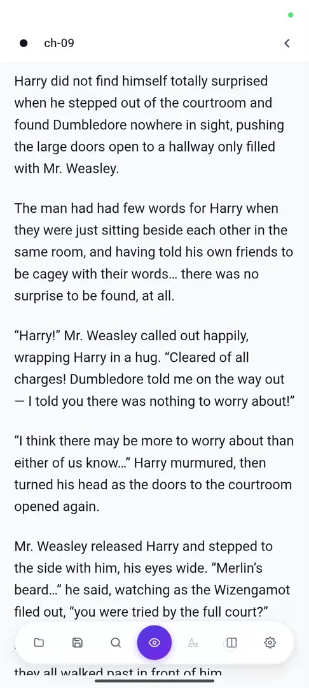<br/>
        <b>6. Mobile Stacked Dual-Pane</b>
      </td>
    </tr>
  </table>
</div>

### Mobile Engineering Highlights
- ⚡ **120Hz/144Hz/165Hz Display Unlock**: Dynamically unlocks your display's maximum refresh rate via `MainActivity.kt` on startup for fluid scrolling.
- 🌊 **Zero-Opacity Container Morph**: Tapping a note card triggers a Xiaomi HyperOS-inspired 380ms scale and clip morph (`cubic-bezier(0.2, 0, 0, 1)`) directly into the full editor with solid `#workspace-shell` color and zero opacity flash.
- 🔐 **Rotary Safe Tumbler Vault HUD**: Swipe down on your notes and steer right to rotate the authentic mechanical safe tumbler dial 90° with ratchet clock-tick haptics to reveal your hidden Private Notes.
- ⌨️ **Gboard Commit Content Integration**: Native Android `InputConnectionCompat` patch in `RustWebView.kt` lets you paste images, stickers, and animated GIFs straight from your virtual keyboard.
- 🔍 **DOM-Safe In-Document Search**: High-performance search powered by CSS Custom Highlight API (`::highlight(cathet-search-match)`), jumping smoothly to occurrences without dismissing Gboard or dropping caret focus.

---

## ⚙️ Settings & Customization Across Platforms

Access Settings via `Ctrl + ,` (or the top-left `●` dot) on Desktop, or tap the settings gear in the mobile drawer on Android:

<div align="center">
  <table>
    <tr>
      <td width="50%" align="center">
        <!--
        📸 SCREENSHOT SPEC #06: WINDOWS SETTINGS MODAL
        - Target File: docs/screenshots/windows-settings-modal.webp
        - Platform: Windows 11 Desktop
        - Theme: Dark Mode
        - Aspect Ratio: 700x636 (2x scale of canonical 350x318 window)
        - State to Capture: Dedicated frosted glass Settings window (`settings.html`) open to Personalization tab. Dark/Light theme toggle, font family select, backdrop options, and Always on Top toggle.
        -->
        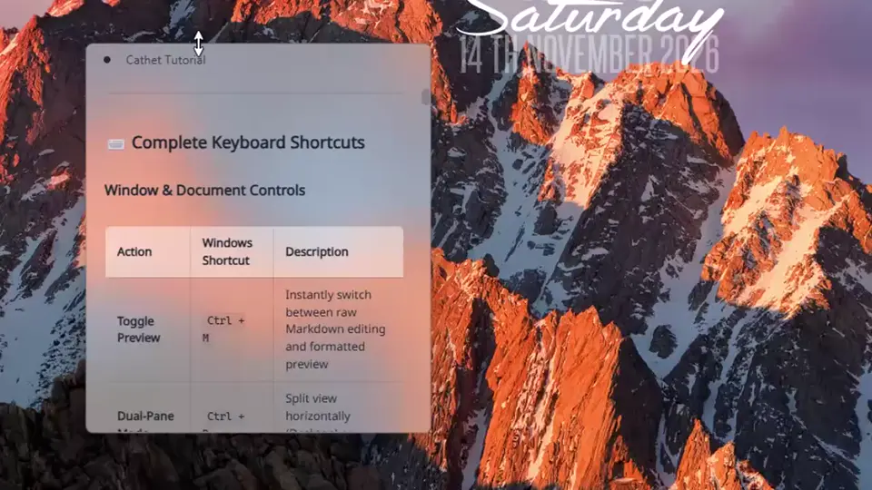<br/>
        <b>Desktop Settings Window (350x318 Frosted Glass)</b>
      </td>
      <td width="50%" align="center">
        <!--
        📸 SCREENSHOT SPEC #16: ANDROID SETTINGS BOTTOMSHEET
        - Target File: docs/screenshots/android-settings-bottomsheet.webp
        - Platform: Android Phone
        - Theme: Dark Mode
        - Aspect Ratio: 1080x2400 (Mobile Portrait 9:20)
        - State to Capture: Android 120fps slide-up bottom sheet Settings view open. Displaying High Refresh Rate toggle (120Hz/144Hz unlock), font options, and appearance controls over dimmed backdrop scrim.
        -->
        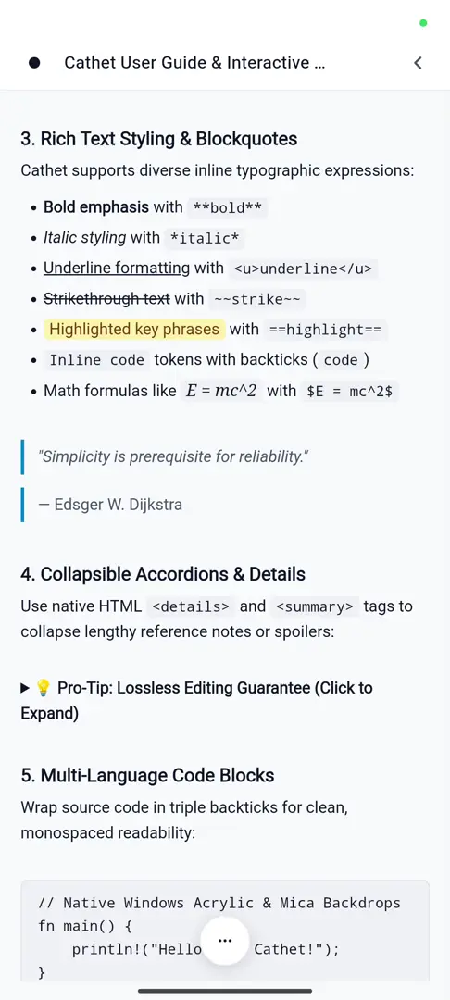<br/>
        <b>Android 120fps Slide-Up Settings Sheet</b>
      </td>
    </tr>
  </table>
</div>

<br/>

<div align="center">
  <!--
  📸 SCREENSHOT SPEC #17: ANDROID THEME CIRCULAR REVEAL
  - Target File: docs/screenshots/android-theme-circular-reveal.webp
  - Platform: Android Phone / Desktop
  - Theme: Theme Switching Transition (Dark to Light or Light to Dark)
  - Aspect Ratio: 1080x2400 (Mobile Portrait) or 1280x720 (Desktop)
  - State to Capture: Midway freeze of hardware-accelerated `document.startViewTransition` with a circular expanding clip mask revealing the opposite theme.
  -->
  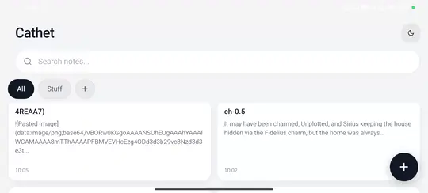<br/>
  <b>Hardware-Accelerated Circular Theme Reveal (`document.startViewTransition`)</b>
</div>

### Customization Options
- **Appearance & Themes**: Toggle sleek Dark glass or bright Light glass with 420ms circular clip-path transition animations.
- **Window Backdrop (Linux)**: Select between Solid Slate (default) and Translucent Glass for KWin force-blur compositors.
- **High Refresh Rate (Android)**: Toggle hardware display refresh rate unlock (120Hz/144Hz/165Hz+) or 60Hz battery saver mode.
- **Typography**: Choose your favorite typeface (*Inter, Roboto, Cascadia Code, JetBrains Mono, Fira Code, Consolas, Segoe UI, Noto Sans, Arial*).
- **Window Controls (Desktop)**: Toggle persistent "Always on Top" floating window (`Ctrl+T`).
- **Markdown Preview Default**: Choose whether saved `.md` files open directly in rendered preview while keeping blank scratchpads in edit mode.
- **Dual-Pane Scroll Sync**: Select between Proportional offset lock, 1:1 Snap scroll alignment, or Independent scrolling.
- **Interactive Offline Tutorial**: Click **"Open Tutorial"** inside Settings to explore markdown formatting and interactive examples directly in the editor.
- **Default Application Integration**: Register Cathet as your system default text application with a single click.

---

## 🚀 How to Get It

You can be up and running in seconds with no complicated installation:

### Windows (Desktop & Laptop)
1. Visit the **[Latest Downloads](https://github.com/Crlyzd/Cathet/releases/latest)** page.
2. Choose the download for your architecture:
   - **`cathet-v...-x64.exe`** (~3.9 MB): Standard Intel or AMD Windows PCs and laptops.
   - **`cathet-v...-arm64.exe`** (~3.6 MB): Modern ARM devices (Microsoft Surface Pro Copilot+, Snapdragon laptops).
   - **`cathet-v....msixbundle`** (~3.7 MB): Microsoft Store multi-architecture bundle combining x64 and ARM64 packages.
3. Double-click the `.exe` to launch immediately! Portable, self-contained, no installer required.

> 💡 **Quick Tip:** Right-click the executable and choose **Pin to taskbar** or **Pin to Start** for instant access.

### Linux (Desktop & Laptop)
1. Download your preferred package format from **[Latest Downloads](https://github.com/Crlyzd/Cathet/releases/latest)**:
   - **Debian / Ubuntu / Linux Mint / Pop!_OS** (`cathet-v...-amd64.deb` ~3.3 MB):
     ```bash
     sudo apt install ./cathet-v...-amd64.deb
     ```
   - **Fedora / RHEL / openSUSE** (`cathet-v...-x86_64.rpm` ~3.3 MB):
     ```bash
     sudo dnf install ./cathet-v...-x86_64.rpm
     ```
   - **Universal Standalone AppImage** (`cathet-v...-x86_64.AppImage` ~78 MB):
     ```bash
     chmod +x cathet-v...-x86_64.AppImage
     ./cathet-v...-x86_64.AppImage
     ```
2. **Cryptographic Release Verification**: Verify authenticity with our public signing key (`cathet-release-key.asc`):
   ```bash
   gpg --import cathet-release-key.asc
   gpg --verify SHA256SUMS.asc SHA256SUMS
   sha256sum --check SHA256SUMS
   ```

### Android (Phone & Tablet)
1. Download from **[Latest Downloads](https://github.com/Crlyzd/Cathet/releases/latest)**:
   - **`cathet-v...-android-arm64.apk`** (~7.2 MB): Optimized for modern 64-bit ARM smartphones and tablets.
   - **`cathet-v...-android.apk`** (~20.9 MB): Universal APK containing all ABIs (`arm64-v8a`, `armeabi-v7a`, `x86_64`).
2. Tap the APK to install on any device running Android 7.0+ (API levels 24 through 36).

---

## ⌨️ Desktop Shortcuts Reference

| Command | Keystroke | Description |
| :--- | :---: | :--- |
| **Toggle Markdown Preview** | `Ctrl + M` | Instant lossless toggle between raw plain text and rendered markdown |
| **Toggle Dual-Pane Mode** | `Ctrl + D` | Split window horizontally with draggable frosted glass splitter |
| **Find in Document** | `Ctrl + F` | High-speed DOM search with CSS custom highlights |
| **Always on Top** | `Ctrl + T` | Pin Cathet floating above all other desktop windows |
| **Open Settings** | `Ctrl + ,` | Launch native frosted glass personalization dialog |
| **New Document** | `Ctrl + N` | Open fresh scratchpad document |
| **Open File** | `Ctrl + O` | Native file picker dialog |
| **Save Document** | `Ctrl + S` | Save current file to disk |
| **Save As** | `Ctrl + Shift + S` | Save document under a new name/location |
| **Paste Content** | `Ctrl + V` | Paste text, markdown tables, or auto-compressed WebP images |
| **Format Styles** | `Ctrl + B` / `I` / `U` | Apply **Bold**, *Italic*, or <u>Underline</u> formatting |
| **Search in Web** | `Ctrl + E` | Look up highlighted text in default web browser |
| **Toggle Word Wrap** | `Alt + W` | Toggle between line wrapping and horizontal code scroll |
| **Zoom Viewport** | `Ctrl + Wheel` | Dynamically scale document text size |
| **Close Window** | `Esc` | Dismiss menus or exit application |

---

## 👆 Mobile Touch Gestures & Navigation

| Action | Gesture / Tap |
| :--- | :--- |
| **Open Note** | Tap any note tile on Home (380ms Xiaomi HyperOS container morph into editor) |
| **Return to Home** | Tap `<` back arrow in top bar (dual-layer collapse into origin tile or `+` FAB) |
| **Unlock Private Notes** | Pull down on notes list and drag right (mechanical rotary safe tumbler with clock-tick haptics) |
| **Search Note Text** | Tap search icon in mobile ribbon (highlight matches without dismissing Gboard) |
| **New Quick Note** | Tap floating circular `+` button |
| **Multi-Select Mode** | Long-press any note card to activate top batch management bar |
| **Batch Note Actions** | Select multiple cards to Pin, Hide, Move between folders, or Delete |
| **Mobile Dual-Pane** | Tap Dual-Pane icon in mobile action bar (vertical stacked split) |
| **Scroll Sync Mode** | Tap splitter badge to cycle: Standard Offset Lock, Snap 1:1, or Paused |
| **Mobile Settings** | Tap gear icon in slide-out drawer (120fps bottom sheet) |
| **Circular Theme Switch** | Tap theme button (hardware-accelerated `startViewTransition` circular reveal) |

---

## 📸 Complete Screenshot Guide & Asset Directory

For contributors or when refreshing screenshots, all image assets live in `docs/screenshots/`:

<details>
<summary><b>View All 17 Screenshot Specifications</b></summary>

<br/>

| # | Asset Filename | Platform | Theme | Captures What |
|---|---|---|---|---|
| 01 | `hero-crossplatform-showcase.jpg` | Composite | Dark | Wide banner showing Windows, Android, and Linux running Cathet |
| 02 | `windows-acrylic-dark-editor.webp` | Windows 11 | Dark | Main editor in Edit mode over wallpaper with frosted Acrylic backdrop |
| 03 | `windows-preview-light.webp` | Windows 11 | Light | Rendered Markdown preview mode on light frosted glass |
| 04 | `windows-dualpane-horizontal.webp` | Windows 11 | Dark | Side-by-side Dual-Pane mode (`Ctrl+D`) with splitter badge |
| 05 | `windows-base64-pill-badge.webp` | Windows 11 | Dark | Collapsible `[ 📷 WEBP ~245 KB ▾ ]` pill badge inline with text |
| 06 | `windows-settings-modal.webp` | Windows 11 | Dark | Dedicated 350x318 frosted glass desktop Settings window |
| 07 | `windows-context-menu-glass.png` | Windows 11 | Dark | Custom frosted glass right-click context menu |
| 08 | `linux-gnome-solid-slate.png` | Linux (GNOME) | Dark | WebKitGTK solid slate canvas (`#12141c`) default mode |
| 09 | `linux-kde-translucent-blur.png` | Linux (KDE) | Dark | Translucent glass mode with KWin force-blur effect |
| 10 | `android-home-dashboard.jpg` | Android | Dark | Notes Home dashboard with category tabs, search, and note cards |
| 11 | `android-vault-rotary-dial.webp` | Android | Dark | Mechanical rotary safe tumbler dial HUD during unlock gesture |
| 12 | `android-home-multiselect.webp` | Android | Dark | Notes Home multi-select mode with top action bar and selected cards |
| 13 | `android-editor-gboard-image.webp` | Android | Dark | Gboard open pasting stickers/GIFs via Commit Content API |
| 14 | `android-in-doc-search.webp` | Android | Dark | In-document search ribbon with CSS highlighted matches and keyboard open |
| 15 | `android-dualpane-vertical.webp` | Android | Dark | Mobile vertical stacked dual-pane with touch dock controls |
| 16 | `android-settings-bottomsheet.webp`| Android | Dark | 120fps slide-up bottom sheet settings view |
| 17 | `android-theme-circular-reveal.webp`| Android/PC | Trans | Expanding circular clip-path transition mask between themes |

</details>

---

## ❓ Frequently Asked Questions

<details>
<summary><b>What operating systems does Cathet support?</b></summary>
<br/>
Cathet is cross-platform across three major ecosystems:
- <b>Windows</b>: Windows 10 and Windows 11 (native x64 and ARM64 executables under 4 MB, plus Microsoft Store MSIX bundles).
- <b>Linux</b>: Modern Linux distributions including Debian, Ubuntu, Fedora, openSUSE, and Arch via native <code>.deb</code>, <code>.rpm</code>, and standalone <code>.AppImage</code> packages.
- <b>Android</b>: Android 7.0 through Android 15+ (API levels 24 to 36) supporting Phone ARM64 and Universal APK packages.
</details>

<details>
<summary><b>How does Cathet handle images and screenshots?</b></summary>
<br/>
Cathet features a built-in in-memory image engine. When you paste an image (<code>Ctrl + V</code> on desktop or via keyboard/clipboard on Android), clips larger than 500 KB are automatically downscaled and converted to WebP in memory to keep file sizes lightweight. In Edit mode, massive Base64 strings collapse into tidy, clickable frosted glass pills (<code>[ 📷 WEBP ~245 KB ▾ ]</code>). In Preview mode (<code>Ctrl + M</code>), Cathet seamlessly renders local relative (<code>./img.png</code>), absolute (<code>C:/...</code>), and web images.
</details>

<details>
<summary><b>Does Cathet require an internet connection?</b></summary>
<br/>
No! Cathet is 100% self-contained and operates completely offline. All styles, fonts, and the interactive tutorial guide are built directly into the app binary. It never transmits telemetry, collects analytics, or tracks your notes.
</details>

<details>
<summary><b>Can I take Cathet with me on a flash drive?</b></summary>
<br/>
Yes! On Windows, Cathet is packaged as a single portable executable under 4 MB. On Linux, it is available as a standalone AppImage. You can copy either to a USB thumb drive and run it immediately without installation or registry writes.
</details>

---

## 🛠️ For Developers & Builders

Cathet uses a unified, authoritative automation pipeline located in the repository root: `build.ps1`.

### Single-Script Automation (`build.ps1`)

```powershell
# 1. Clone repository & install frontend modules
git clone https://github.com/Crlyzd/Cathet.git
cd Cathet
npm install

# 2. Desktop Live Development (hot-reload)
.\build.ps1 -Live

# 3. Android Live Development (hot-reload with ADB reverse port forwarding)
.\build.ps1 -AndroidDev

# 4. Windows Desktop Release Builds (placed in release/)
.\build.ps1 -BuildX64     # Windows x64 (~3.9 MB -> release/cathet-v<version>-x64.exe)
.\build.ps1 -BuildArm64   # Windows ARM64 (~3.6 MB -> release/cathet-v<version>-arm64.exe)
.\build.ps1 -BuildMsix    # Microsoft Store package -> release/cathet-v<version>.msixbundle
.\build.ps1 -AllWindows   # Build all three Windows release targets

# 5. Linux Release Builds (Debian, Red Hat, AppImage & Signing)
.\build.ps1 -BuildDeb     # Debian / Ubuntu package (~3.3 MB -> release/cathet-v<version>-amd64.deb)
.\build.ps1 -BuildRpm     # Fedora / Red Hat package (~3.3 MB -> release/cathet-v<version>-x86_64.rpm)
.\build.ps1 -BuildAppImage # Standalone AppImage (~78 MB -> release/cathet-v<version>-x86_64.AppImage)
.\build.ps1 -AllLinux     # Build & digitally sign all Linux packages via GPG

# 6. Android Release Builds (Phone ARM64 & Universal APKs)
.\build.ps1 -AndroidArm64 # Phone ARM64 APK (~7.2 MB -> release/cathet-v<version>-android-arm64.apk)
.\build.ps1 -AndroidBuild # Universal APK (~20.9 MB -> release/cathet-v<version>-android.apk)
.\build.ps1 -AndroidAll   # Build both ARM64 and Universal APKs

# 7. Quality Assurance & Housekeeping
.\build.ps1 -Check        # Synchronous verification: runs npx tsc --noEmit and cargo check
.\build.ps1 -Clean        # Purge local and WSL build caches (~9.6 GB reclaimed)
```

All compiled binaries are placed into `release/` with minimal size profiles (`opt-level = "z"`, stripped symbols, native Windows Schannel TLS on Windows and Rustls on Android/Linux).

---

## ❤️ Support & Feedback

Cathet is free, open-source, and crafted with care.
- ⭐ If you enjoy Cathet, give the repository a star on GitHub!
- 🐛 Found a bug or have a suggestion? [Open an issue](https://github.com/Crlyzd/Cathet/issues).
- ☕ Support the creator via [Saweria](https://saweria.co/crlyzd) or [PayPal](https://paypal.me/crlyzd).

---

## 📄 License

Cathet is open-source software licensed under the [GNU General Public License v3.0](LICENSE) (GPL-3.0-or-later).  
Copyright © 2026 Crlyzd.
